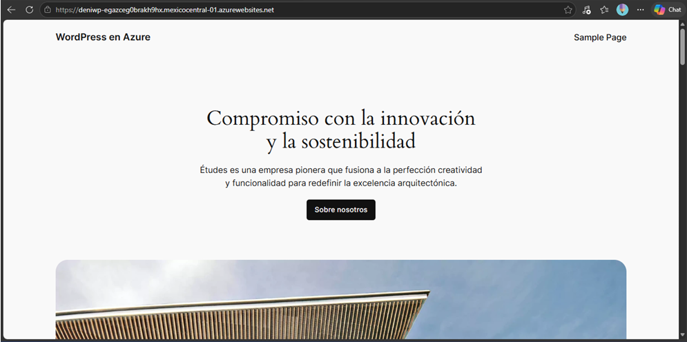
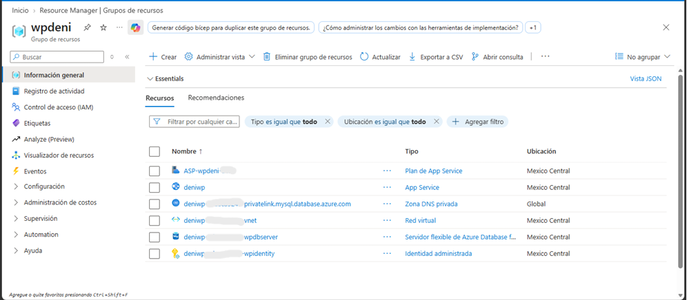
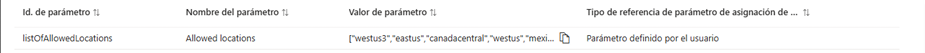
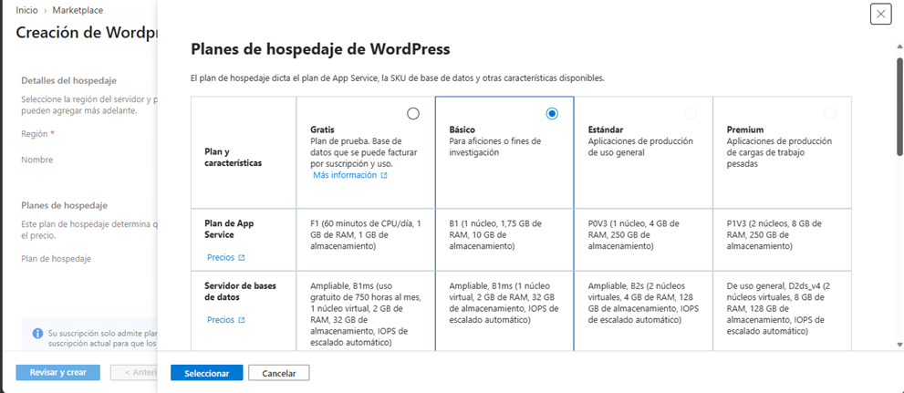
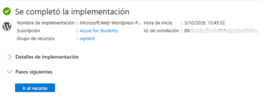
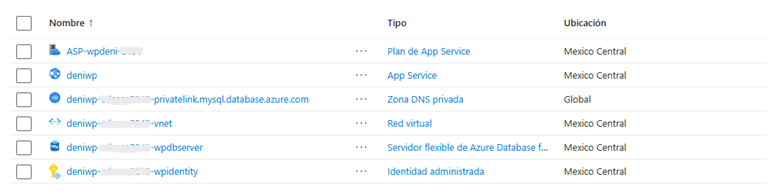
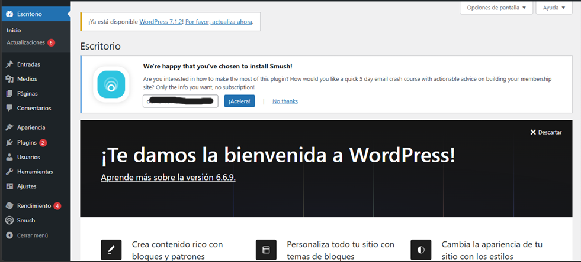
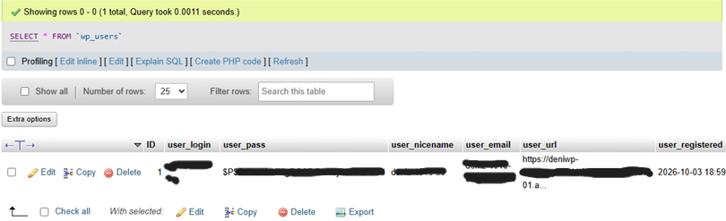
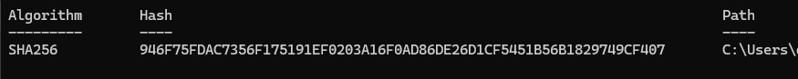
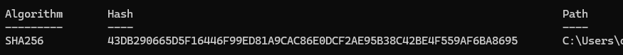

# WordPress en Azure App Service: despliegue, administración y hash de contraseñas

Laboratorio del curso **Fundamentos de Ciberseguridad con Tecnologías Microsoft** (INFOTEC).
Despliegue de un sitio WordPress en Azure App Service, administración de su base de datos MySQL y comprobación de cómo se almacenan las contraseñas mediante **hash**.



## Qué hice
- Creé un **grupo de recursos** y verifiqué las regiones permitidas por la directiva de la suscripción.
- Desplegué **WordPress** desde el Marketplace de Azure con el plan gratuito.
- Revisé los recursos que Azure crea automáticamente (base de datos, red virtual e identidades administradas).
- Accedí al panel de WordPress (`/wp-admin`) y a **phpMyAdmin** para administrar la base de datos.
- Revisé el **escalado vertical** del plan de App Service.
- Comprobé en la tabla `wp_users` que las contraseñas se guardan como **hash**, y calculé un hash **SHA-256** en PowerShell.

## Tecnologías
Azure App Service · WordPress · MySQL · phpMyAdmin · Azure Policy · PowerShell

## Pasos

### Parte 1 · Despliegue de WordPress (App Service)

1. **Grupo de recursos:** en `portal.azure.com` creé un grupo de recursos con un nombre identificable, en una región permitida por la suscripción.
2. **Verificar regiones permitidas:** *Directiva → Cumplimiento → asignación → Ver asignación*; las regiones habilitadas aparecen entre corchetes.
3. **Crear WordPress:** busqué **WordPress** en el Marketplace (ícono *Azure Service*) → **Crear**.
4. **Configurar:**
   - Plan: **gratuito**
   - Grupo de recursos: el creado en el paso 1
   - Región: una de las permitidas
   - Nombre de la aplicación: único (define el dominio `.azurewebsites.net`)
   - Correo del administrador, idioma y contraseña
5. **Revisar y crear:** esperé la validación en verde y confirmé con **Crear**.
6. **Resultado:** Azure desplegó varios recursos relacionados (base de datos, red virtual, identidades administradas), por eso tarda unos minutos.

> Error común: *región no permitida*. Se resuelve eligiendo una región de la lista de *Ver asignación*.

### Parte 2 · Administración y hash

1. **Abrir el sitio:** desde *Introducción* del App Service, con el dominio predeterminado.
2. **Panel de WordPress:** añadí `/wp-admin` a la URL.
3. **Panel de base de datos:** añadí `/phpmyadmin`. Usa un usuario y contraseña **distintos** a los de WordPress; se consultan en *Configuración → Variables de entorno → Cadenas de conexión*.
4. **Escalar:** *Plan de App Service → Escalar verticalmente* para comparar CPU, memoria, SLA y precio entre planes.
5. **Revisar el hash:** en phpMyAdmin, tabla `wp_users`: el campo de contraseña muestra un **hash**, no la contraseña real.
6. **Calcular un hash en PowerShell** (ejemplo con una imagen):
   ```powershell
   Get-FileHash .\imagen.png -Algorithm SHA256
   ```
   Al modificar un solo píxel y recalcular, el hash cambia por completo.

## Capturas
| Paso | Captura |
|---|---|
| Grupo de recursos creado |  |
| Regiones permitidas por la directiva |  |
| Crear WordPress (plan gratuito) |  |
| Validación correcta |  |
| Recursos desplegados |  |
| Panel `/wp-admin` |  |
| Tabla `wp_users` con hash |  |
| Hash SHA-256 original |  |
| Hash tras modificar un píxel |  |

## Lo que aprendí
- Un **App Service** es **PaaS**: Azure administra la infraestructura y yo me enfoco en la aplicación.
- Un solo recurso (WordPress) despliega **varios recursos relacionados**.
- La **región** afecta latencia, costo y cumplimiento, y la directiva de la suscripción puede limitarla.
- Diferencia entre **escalado vertical** (más potencia) y **horizontal** (más instancias).
- Las contraseñas se guardan como **hash**: si la base de datos se compromete, no se ven las contraseñas reales.
- Un cambio mínimo en un archivo produce un hash totalmente distinto, útil para verificar **integridad**.
- Las credenciales de WordPress y de la base de datos son **distintas**.

> Nota: el sitio funcionó durante el curso y el recurso puede ya no estar activo. Las capturas muestran el resultado. Por seguridad, las contraseñas, correos, cadenas de conexión e identificadores de suscripción están ocultos en las imágenes.

 Copyright (c) 2026 Irma (Deni-0295). Todos los derechos reservados.

Este repositorio y su contenido (reportes, documentos, imágenes y textos) son propiedad de la autora. No se permite copiar, modificar, distribuir ni utilizar este material, total o parcialmente, sin autorización previa y por escrito.
