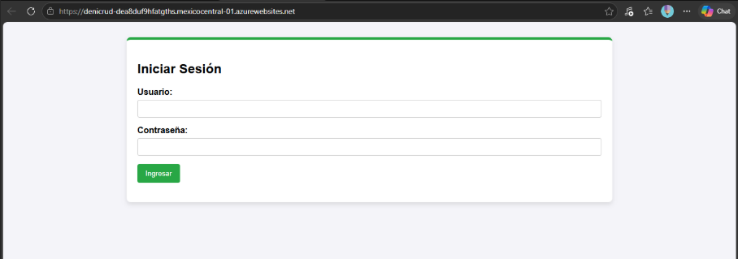
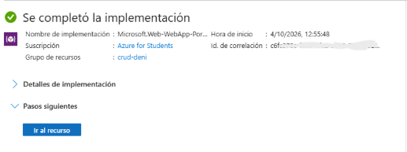
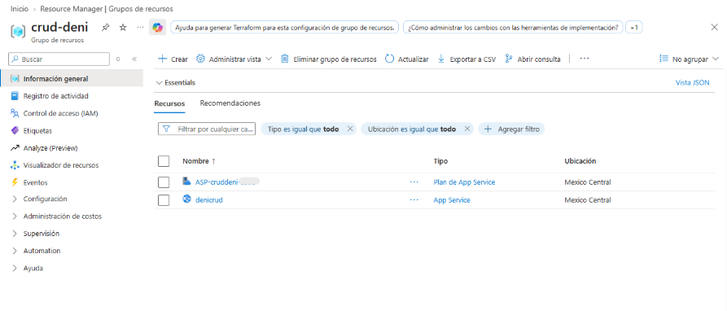
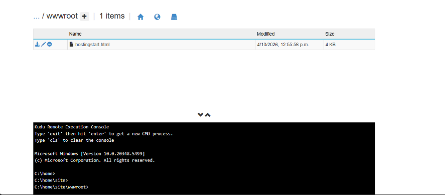
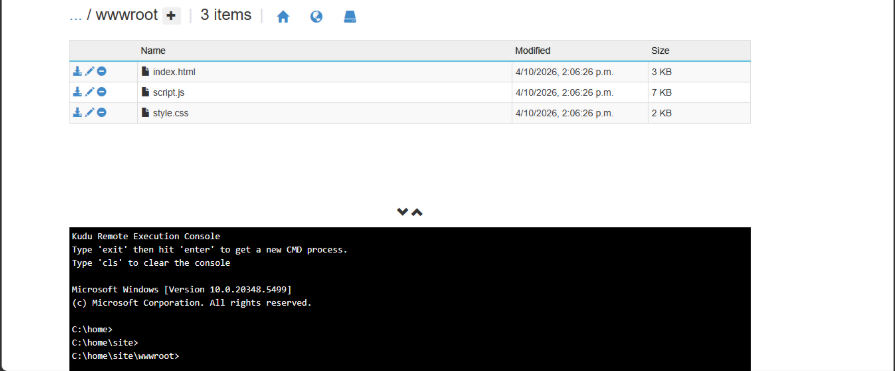
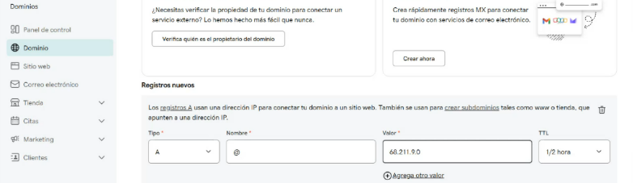
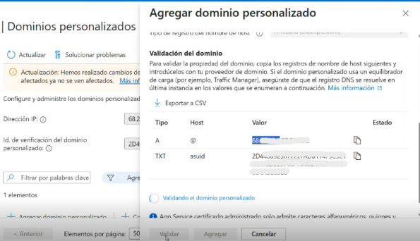
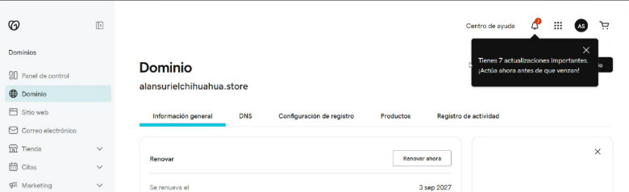
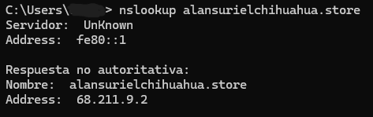

# CRUD en Azure App Service con Kudu y dominio personalizado

Laboratorio del curso **Fundamentos de Ciberseguridad con Tecnologías Microsoft** (INFOTEC).
Despliegue manual de un proyecto **CRUD** (HTML y JavaScript) en Azure App Service usando **Kudu**, y configuración de un **dominio personalizado** con registros DNS y HTTPS.



## Qué hice
- Creé una **aplicación web (App Service)** en Azure con el plan gratuito.
- Abrí **Kudu** y subí los archivos del proyecto CRUD a la carpeta `site/wwwroot`.
- Verifiqué el sitio publicado y probé los **roles** de la aplicación (administrador y usuario normal).
- Revisé cómo se conecta un **dominio personalizado** a un App Service: registros **A** y **TXT**, validación y certificado TLS.
- Comprobé a dónde apunta un dominio con `nslookup`.

## Tecnologías
Azure App Service · Kudu · JavaScript / jQuery · DNS (registros A y TXT) · HTTPS/TLS · nslookup

## Pasos

### Parte 1 · Despliegue del CRUD con Kudu

1. **Materiales:** descargué la carpeta del proyecto CRUD (3 archivos) desde los archivos compartidos del curso.
2. **Crear el App Service** desde el portal de Azure:
   - Grupo de recursos nuevo y nombre único de la instancia
   - Publicar: **código**
   - Pila: **ASP.NET 4.8**
   - Sistema operativo: **Windows**
   - Región: una permitida por la directiva de la suscripción
   - Plan: gratuito (F1) o básico
3. **Abrir Kudu:** *Herramientas de desarrollo → Herramientas avanzadas → Ir*.
4. **Ir a la raíz del sitio:** *Debug Console → CMD → `site/wwwroot`*.
5. **Eliminar** el archivo por defecto `hostingstart.html`.
6. **Subir los 3 archivos** del proyecto arrastrándolos a la ventana de Kudu (los archivos, no la carpeta).
7. **Verificar:** abrí el dominio predeterminado (`nombre.azurewebsites.net`); debe aparecer la pantalla de inicio de sesión del CRUD.

> El CRUD funciona del lado del cliente (JavaScript y jQuery, con almacenamiento temporal en el navegador) y **no se conecta a una base de datos real**. Incluye un usuario administrador, que puede crear, editar y eliminar usuarios, y un usuario normal sin esos permisos. Las contraseñas se muestran cifradas con **SHA-256**.

### Parte 2 · Dominio personalizado

> Estado: **en proceso**. Requiere un dominio propio y, como mínimo, el plan **Básico (B1)**.

1. **Registrar un dominio** en un proveedor (por ejemplo, GoDaddy) o desde Azure. Los dominios se **rentan por periodos** y deben renovarse.
2. **Subir el plan** a **Básico (B1)**: *Plan de App Service → Escalar verticalmente*. El plan gratuito no permite dominios personalizados.
3. **Agregar el dominio:** *Configuración → Dominios personalizados → Agregar dominio personalizado*. Si el dominio se compró fuera de Azure, elegir **"Todos los demás servicios"** y dejar el certificado TLS administrado.
4. **Crear los registros DNS** en el panel del proveedor del dominio, los que Azure indica:
   - Registro **A**: apunta el dominio a la **IP** del App Service
   - Registro **TXT**: **verifica la propiedad** del dominio
5. **Validar** en Azure. La propagación puede tardar hasta 48 horas, aunque suele ser casi inmediata.
6. **Probar con HTTPS:** abrir el sitio con `https://`; con `http://` el navegador puede marcarlo como "no seguro".
7. **Comprobar el DNS:**
   ```bash
   nslookup tu-dominio.com
   ```

## Capturas
| Paso | Captura |
|---|---|
| Crear el App Service |  |
| Recurso desplegado |  |
| Kudu: carpeta `site/wwwroot` |  |
| Archivos del CRUD subidos |  |
| Agregar dominio personalizado |  |
| Registros DNS (A y TXT) |  |
| Sitio con HTTPS en el dominio |  > Nota: el dominio solo se hizo uno en el curso, ya que se necesita comprar |
| Resultado de `nslookup` |  |

## Lo que aprendí
- **CRUD** significa *Create, Read, Update, Delete*: las operaciones básicas de cualquier sistema que gestiona datos.
- **Kudu** permite subir y gestionar archivos de un App Service desde el navegador, sin Git.
- `site/wwwroot` es la **raíz pública** del sitio.
- El **control de acceso por roles** limita lo que puede hacer cada tipo de usuario.
- **Dominio** (la dirección) y **hosting** (dónde está alojada la app) son cosas distintas y pueden contratarse con proveedores diferentes.
- Un dominio se **renta**; no es una compra única.
- Para conectar un dominio: registro **A** (apunta a la IP) y registro **TXT** (verifica la propiedad).
- Un dominio personalizado en App Service necesita como mínimo el plan **Básico (B1)**.
- **HTTPS/TLS** cifra la comunicación; el candado indica conexión cifrada, **no que el sitio sea legítimo**.
- `nslookup` muestra la IP real detrás de un dominio.

> Nota: el sitio funcionó durante el curso y el recurso puede ya no estar activo. Las capturas muestran el resultado. Por seguridad, el ID de suscripción, los correos y las cuentas del curso están ocultos en las imágenes.

Copyright (c) 2026 Irma (Deni-0295). Todos los derechos reservados.

Este repositorio y su contenido (reportes, documentos, imágenes y textos) son propiedad de la autora. No se permite copiar, modificar, distribuir ni utilizar este material, total o parcialmente, sin autorización previa y por escrito.
